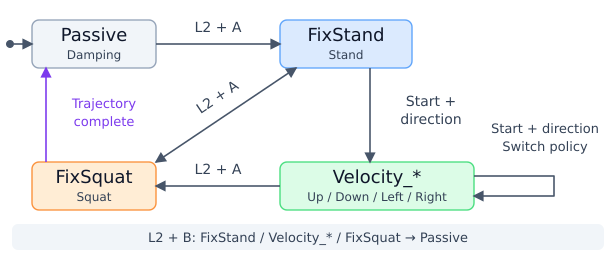

<div align="center">
  <h1>Go2 RL CPP Deploy</h1>
  <p><a href="README.md">🌎 English</a> | <strong>🇨🇳 中文</strong></p>
</div>

在 Unitree Go2 Edu 上部署强化学习策略，可在 Orin NX 上运行，也可通过以太网连接外部电脑。参考 [unitree_rl_lab](https://github.com/unitreerobotics/unitree_rl_lab)。适用于 [go2_rl_lab](https://github.com/wty-yy/go2_rl_lab) 仓库模型的真机部署。

<table width="100%">
  <thead>
    <tr>
      <th width="33%" align="center"><div align="center">台阶</div></th>
      <th width="33%" align="center"><div align="center">前进 3.5 m/s，后退 4.4 m/s</div></th>
      <th width="33%" align="center"><div align="center">奔跑（俯视）</div></th>
    </tr>
  </thead>
  <tbody>
    <tr>
      <td align="center"></td>
      <td align="center"></td>
      <td align="center"></td>
    </tr>
  </tbody>
</table>

<table width="100%">
  <thead>
    <tr>
      <th width="50%" align="center"><div align="center">斜坡</div></th>
      <th width="50%" align="center"><div align="center">楼梯间</div></th>
    </tr>
  </thead>
  <tbody>
    <tr>
      <td align="center"></td>
      <td align="center"></td>
    </tr>
  </tbody>
</table>

> 上述所有演示均由 [go2_mixed_moe_cts_v1.3.2resume_74k_0.687](logs/go2/go2_rl_lab/go2_mixed_moe_cts_v1.3.2resume_74k_0.687) 单一模型实现，使用 `Start + Up` 切换。

## 📦 安装与编译

```bash
# 安装依赖和 Git LFS
sudo apt install git-lfs libboost-program-options-dev libyaml-cpp-dev libeigen3-dev libfmt-dev libspdlog-dev
git lfs install

# 拉取 go2 分支及五个 ONNX 策略
git clone --branch go2 --single-branch https://github.com/wty-yy/unitree_cpp_deploy.git
cd unitree_cpp_deploy
git lfs pull
```

安装 [unitree_sdk2](https://github.com/unitreerobotics/unitree_sdk2)，将对应架构的 ONNX Runtime 解压到 `deploy/thirdparty/`。

| 部署平台 | ONNX Runtime | 解压路径 |
|---|---|---|
| Orin NX | [aarch64 1.16.0](https://github.com/csukuangfj/onnxruntime-libs/releases/download/v1.16.0/onnxruntime-linux-aarch64-gpu-1.16.0.tar.bz2) | deploy/thirdparty/onnxruntime-linux-aarch64-gpu-1.16.0 |
| x64 Linux | [x64 1.24.2](https://github.com/microsoft/onnxruntime/releases/download/v1.24.2/onnxruntime-linux-x64-gpu-1.24.2.tgz) | deploy/thirdparty/onnxruntime-linux-x64-gpu-1.24.2 |

CMake 会自动选择对应架构的 ONNX Runtime。

编译命令如下：

```bash
cd deploy/robots/go2
cmake -B build && cmake --build build -j$(nproc)
```

## 🚀 运行

### 🤖 Real Hardware

真机部署时，先使用官方遥控器按两次 L2 + A，使机器人趴下。随后启动本运控程序，程序会自动停止官方运控并接管控制。

```bash
# Orin NX，网卡按实际连接修改
./build/go2_ctrl -n eth0
```

### 🖥️ MuJoco Simulator

参考 [unitree_mujoco（go2 分支）](https://github.com/wty-yy/unitree_mujoco/tree/go2) 中的安装方法。完成安装后，先启动仿真器，再在另一终端启动控制程序：

```bash
# 在 unitree_mujoco 仓库根目录运行
./simulate/build/unitree_mujoco

# 在另一终端中，进入本仓库的 deploy/robots/go2 目录运行
./build/go2_ctrl -n lo
```

### 🎮 按键操作

| 按键 | 功能 |
|---|---|
| L2 + A | Passive → 站立；站立 / 策略 → 蹲下；蹲下 → 站立 |
| Start + Up / Down / Left / Right | 从站立或其他策略切换到对应策略 |
| L2 + B | 切换到 Passive 阻尼模式 |
| 按住 RT | 使用当前模型定义的 boost 指令范围 |
| L2 + Y | 启停固定指令，需先启用 `fixed_command.enabled` |

蹲下轨迹完成后自动进入 Passive。固定指令默认关闭。按键与状态参数见 [config.yaml](deploy/robots/go2/config/config.yaml)。



按键操作演示：

https://github.com/user-attachments/assets/d27f4d4b-208e-4212-b829-ad835e53c162

## 🛠️ 使用

### 🧠 策略

五个策略位于 [logs/go2/](logs/go2/)，每个包含 `exported/policy.onnx` 和 `params/deploy.yaml`。ONNX 通过 Git LFS 管理。

| 状态 | 策略目录（相对于 logs/go2） |
|---|---|
| Velocity_Up | [go2_rl_lab/go2_mixed_moe_cts_v1.3.2resume_74k_0.687](logs/go2/go2_rl_lab/go2_mixed_moe_cts_v1.3.2resume_74k_0.687) |
| Velocity_Down | [go2_rl_gym/go2_moe_cts_164k_0.6715](logs/go2/go2_rl_gym/go2_moe_cts_164k_0.6715) |
| Velocity_Left | [go2_rl_lab/go2_mixed_moe_cts_v1.3_8192_89k_0.69](logs/go2/go2_rl_lab/go2_mixed_moe_cts_v1.3_8192_89k_0.69) |
| Velocity_Right | [go2_rl_lab/go2_mixed_moe_cts_v1.3.2resume_82.5k_0.6929](logs/go2/go2_rl_lab/go2_mixed_moe_cts_v1.3.2resume_82.5k_0.6929) |
| 未绑定按键 | [go2_rl_robotlab/go2_moe_cts_v4.2_176k_0.6984](logs/go2/go2_rl_robotlab/go2_moe_cts_v4.2_176k_0.6984) |

`go2_rl_robotlab` 作为额外 checkpoint 保留。使用时将对应状态的 `policy_dir` 指向该目录。

#### ⚡ 加速模式

普通速度范围由各模型 `params/deploy.yaml` 中的 `commands.base_velocity.ranges` 定义。Up、Left 和 Right 还配置了 `boost.ranges`：

| 状态 | 纵向（m/s） | 横向（m/s） | 转向（rad/s） | YAML 路径 |
|---|---|---|---|---|
| Velocity_Up | `[-4.5, 4.2]` | `[-0.5, 0.5]` | `[-1.0, 1.0]` | [deploy.yaml](logs/go2/go2_rl_lab/go2_mixed_moe_cts_v1.3.2resume_74k_0.687/params/deploy.yaml#L14) |
| Velocity_Left | `[-4.0, 4.0]` | `[-0.5, 0.5]` | `[-1.0, 1.0]` | [deploy.yaml](logs/go2/go2_rl_lab/go2_mixed_moe_cts_v1.3_8192_89k_0.69/params/deploy.yaml#L14) |
| Velocity_Right | `[-4.5, 3.0]` | `[-0.5, 0.5]` | `[-1.0, 1.0]` | [deploy.yaml](logs/go2/go2_rl_lab/go2_mixed_moe_cts_v1.3.2resume_82.5k_0.6929/params/deploy.yaml#L14) |

默认通过 `RT` 启用 boost，可在 [config.yaml](deploy/robots/go2/config/config.yaml) 中通过 `boost_button` 配置按钮。目前仅 `go2_rl_lab` 模型配置了 boost。

策略目录相对于 [deploy/robots/go2/](deploy/robots/go2/) 解析。替换模型时同步更新 `policy.onnx` 和 `deploy.yaml`。

### ⚙️ 配置与工具

[config.yaml](deploy/robots/go2/config/config.yaml) 的 `Velocity_Right` 下提供以下可选配置，将对应配置中的 `enabled` 设为 `true` 即可启用，可按需复制到其他 FSM 状态。

| 配置 | 使用方法 |
|---|---|
| `velocity_command_damping` | 通过 `vx.speed_points` 和 `vx.time_constants` 平滑纵向指令，通过 `vx.max_acceleration` 和 `vx.max_deceleration` 限制加减速。 |
| `logging` | 通过 `dt` 设置采样间隔（秒），CSV 文件保存到策略目录的 `logs/` 下。 |
| `fixed_command` | 设置 `lin_vel_x`、`lin_vel_y`、`ang_vel_z` 和 `duration`（秒），通过 `L2 + Y` 启停预设指令。 |
| `joint_pos_udp` | 设置接收端的 `host`、`port` 和发送间隔 `dt`（秒），发送 12 个关节的实测位置；接收示例见 [udp_test.py](scripts/udp_test.py)。 |

FSM 和按键配置见 [robot_params.md](docs/robot_params.md)，观测分组见 [obs_group.md](docs/obs_group.md)。其他资源：[可视化脚本](deploy/tools/) 和 [Go2 URDF](resources/go2.urdf)。

## 📄 许可证

项目自有代码采用 [MIT 许可证](LICENSE)。Unitree 派生代码的 Apache 2.0 条款见 [Unitree RL Lab 许可证](docs/licenses/unitree-rl-lab-license.txt)。

## 📚 引用

如果您觉得模型策略有用，请引用：

```bibtex
@INPROCEEDINGS{WuT-RSS-26,
    AUTHOR    = {Tianyang Wu AND Hanwei Guo AND Yuhang Wang AND Junshu Yang AND Xinyang Sui AND Jiayi Xie AND Xingyu Chen AND Zeyang Liu AND Xuguang Lan},
    TITLE     = {{Toward Reliable Sim-to-Real Predictability for MoE-based Robust Quadrupedal Locomotion}},
    BOOKTITLE = {Proceedings of Robotics: Science and Systems},
    YEAR      = {2026},
    ADDRESS   = {Sydney, Australia},
    MONTH     = {July},
    DOI       = {10.15607/RSS.2026.XXII.156}
}
```
